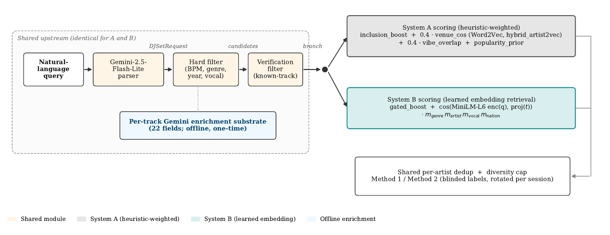
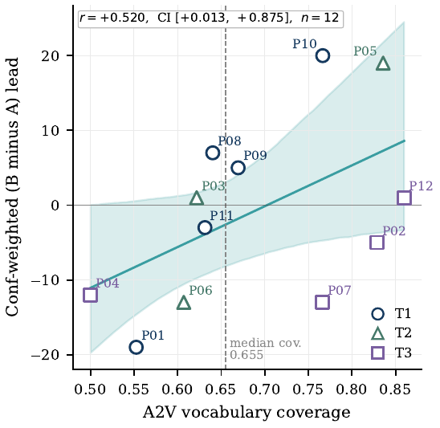

# dj-playlist-generation

**Natural language → DJ set, from your own library.** My MSc dissertation at the Centre for Digital Music (C4DM), Queen Mary University of London: type *"warm, groovy minimal house to open, building into peak-time techno"* and get back a sequenced playlist drawn from your private Rekordbox collection — not from a streaming catalog. Graded 83% (Distinction).

> **The code lives in a private repository.** I'm happy to walk through it or grant access for review — email [segalladin@gmail.com](mailto:segalladin@gmail.com). The full dissertation, slides, figures, and a 10-minute demo video are public here.

[**Demo video**](../../releases/latest) · [**Dissertation (PDF)**](Segall_MSc_Dissertation.pdf) · [**Slides**](slides.pdf)

## The research question

A DJ's private library has no play history and no collaborative-filtering signal to lean on. So what should rank the candidates — hand-built domain heuristics, or learned embeddings? The dissertation answers this with a controlled A/B study:

- **System A — heuristic.** Weighted scoring over a Word2Vec "venue cosine" (a `hybrid_artist2vec` model with a 202,528-token vocabulary, trained on 1001Tracklists, MixesDB, and Spotify Million Playlist Dataset corpora), LLM-tag vibe overlap, and a popularity prior.
- **System B — learned-embedding retrieval.** A frozen MiniLM-L6 query encoder with a trainable 384→256→128 projection head, scored against a learned track projector anchored in artist2vec space (InfoNCE objective), gated by genre / artist / vocal / nationality multipliers.

Both systems share an identical upstream — one Gemini-2.5-Flash-Lite parse per query into a structured `DJSetRequest`, the same hard filters, and the same offline 22-field-per-track enrichment substrate — so the study isolates exactly one variable: the ranking step.



## The study

Twelve DJs, blinded within-subject design (QMUL ethics approval QMERC DSEECS25.063), each running natural-language requests against their **own** library and rating paired playlists under rotated blinded labels.

**Headline result, reported honestly: a tie.** Raw preference 37/36; confidence-weighted 131/119. But the aggregate hides structure — the learned system's per-participant lead tracks how much of that participant's library its embedding vocabulary actually covers: **Pearson r = +0.520 (95% CI [+0.013, +0.875], n = 12)**. System B wins where its embeddings know the library, and loses where they don't. That coverage dependency, not a blanket winner, is the finding.



## Under the hood

- **LLM outputs you can trust at corpus scale** — every track enrichment passes a two-layer schema: Pydantic `Literal`-typed fields plus a two-retry post-validator, holding a **97.2% validation pass rate** across the corpus.
- **A real evaluation harness** — frozen-fixture regression evals for the ranking stack, an A/B comparison harness, automated per-playlist audits, and per-session blinded label maps.
- **Data engineering** — Playwright scraper → Parquet tracklist corpus; Rekordbox XML parsing; Spotify/Beatport metadata reconciliation; Word2Vec and sentence-transformer training pipelines. Python 3.12 / Poetry; ~3,000-line Streamlit study app plus a CLI with a feedback loop.
- **Honest failure analysis** — the write-up documents a popularity-prior leak under hard-constraint queries, a RAG layer that failed encoder-transfer sanity checks (shipped off, documented as future work), and the limits of n = 12 — because carefully-reported null results are still results.

## In this repo

- [`Segall_MSc_Dissertation.pdf`](Segall_MSc_Dissertation.pdf) — the full dissertation
- [`slides.pdf`](slides.pdf) — the demo/viva slide deck
- [`figures/`](figures/) — pipeline and results figures
- demo video on the [releases page](../../releases/latest)

## Citation

```bibtex
@mastersthesis{segall2026djnlp,
  author  = {Adin Segall},
  title   = {Heuristic vs. Learned-Embedding Retrieval for Natural-Language Playlist
             Generation in Private DJ Libraries: A Controlled A/B User Study},
  school  = {Queen Mary University of London, Centre for Digital Music},
  year    = {2026},
  type    = {MSc Dissertation}
}
```

---

© Adin Segall 2026. Thesis and figures are shared for reading; the code is available on request. Participant data from the user study is excluded in accordance with the approved ethics protocol.
